# YF-500 V1

文档AI等级：4

<figure markdown>
  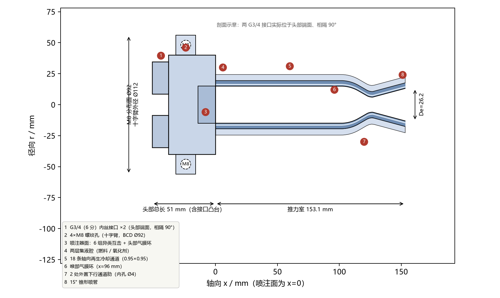{ height="400" }
</figure>

YF-500 是本站记录的一台 500 N 级液氧/乙醇液体火箭发动机，V1 为该系列的初始方案：海平面设计推力 500 N、燃烧室压力 3.0 MPa、氧燃比 1.0，燃料为 95% 乙醇（质量分数），氧化剂为气氧，采用燃料逆流再生冷却加头部/喉部气膜冷却，整机以 316L 不锈钢经金属 3D 打印（SLM）一次成形，估算质量约 1.35 kg，单次工作时间 15 s。

V1 的设计参数由 RPA 类热力计算与自编脚本共同给出，几何、喷注器与冷却三部分的取值均以表格形式留存于原始资料；本页只做转录整理，未对任何数值做换算、修正或取舍。三维模型提供 STEP、STL 与 SolidWorks 源文件三种格式，可直接用于复现或二次设计。

## 总体参数

| 参数 | 数值 | 说明 |
| -- | ---- | ---- |
| 型号 | YF-500 | — |
| 设计推力（海平面） | 500 N | 额定工作点 |
| 燃烧室压力 \(p_c\) | 3.0 MPa | — |
| 氧燃比 O/F | 1.0 | 富燃 |
| 工作时间 | 15 s | 单次工作 |
| 燃料 | 95% 乙醇（质量分数） | 入口 298.15 K |
| 氧化剂 | 气氧 | 入口 280 K，入口压力 3.5 MPa |
| 冷却方式 | 再生冷却 + 气膜冷却 | 燃料逆流冷却 |
| 材料与工艺 | 316L 不锈钢，金属 3D 打印（SLM） | 整体一次成形 |
| 点火方式 | 从喷管出口插入点火头 | 无专用点火器接口 |
| 发动机质量（估算） | ≈1.35 kg | 打印毛坯 1.6~1.8 kg |
| 总推进剂消耗 | 3.345 kg | 氧 1.672 kg + 燃料 1.672 kg |

## 性能参数

| 参数 | 海平面 | 真空 |
| -- | ---- | ---- |
| 理论比冲 \(I_{sp}\) | 242.32 s | 268.20 s |
| 交付比冲 \(I_{sp}\) | 228.64 s | 254.52 s |
| 交付推力 | 500 N | ≈557 N |
| 有效排气速度 | 2242.2 m/s | 2496.0 m/s |
| 推力系数 \(C_F\)（交付 / 理论） | 1.4176 / 1.4625 | 1.5781 / 1.6188 |
| 特征速度 \(c^*\)（交付 / 理论） | 1581.66 / 1624.80 m/s | — |
| 燃烧室温度 \(T_c\) | 2544.69 K | — |
| 燃气比热比 \(\gamma\) / 气体常数 R | 1.2136 / 441.01 J/(kg·K) | — |
| 燃气平均分子量 | 18.853 g/mol | — |
| 总质量流量 | 0.2230 kg/s（氧 / 燃料各 0.1115 kg/s） | — |

「特征速度」及以下五行属燃烧室单一状态量，原表未区分海平面与真空，真空列留空，本表以「—」表示。

## 推力室与喷管参数

| 参数 | 数值 | 参数 | 数值 |
| -- | ---- | -- | ---- |
| 喷管扩张比 \(\varepsilon\) | 4.6 | 燃烧室收缩比 \(\varepsilon_c\) | 6.0 |
| 特征长度 \(L^*\) | 700 mm | 燃烧室容积 | 82.3 cm³ |
| 喉部直径 \(D_t\) | 12.23 mm | 喉部面积 \(A_t\) | 1.176e-04 m² |
| 喷管出口直径 \(D_e\) | 26.24 mm | 喷管出口面积 \(A_e\) | 5.408e-04 m² |
| 燃烧室直径 \(D_c\) | 29.97 mm | 喷管出口压力 \(p_e\) | 0.0994 MPa |
| 圆柱段长度 \(L_{cyl}\) | 101.16 mm | 燃烧室总长 \(L_c\) | 126.61 mm |
| 喷管扩张段长度 \(L_e\) | 26.44 mm | 燃气通道总长 | 153.1 mm |
| 收敛半角 | 30° | 喷管半角 | 15°（锥形） |
| 喉部上游圆弧 \(R_1\) | 9.18 mm | 喉部下游圆弧 \(R_n\) | 2.34 mm |
| 收敛段过渡圆弧 \(R_2\) | 28.50 mm | 喷管发散效率 | 0.9830 |

原表按左右两栏并排排版，左右两栏各自独立排列，同一行左右两项之间没有对应关系；本表保留原分栏顺序。

## 喷注器参数

| 参数 | 数值 |
| -- | ---- |
| 喷注器形式 | 异类互击式（气-液双股互击） |
| 单元数量 | 6 组，均布于 Ø16.0 mm 圆周，间隔 60° |
| 互击角 | 60°（每侧 30°） |
| 两孔中心距 / 撞击距离 | 3.2 mm / 2.77 mm |
| 燃料喷注孔直径 | Ø1.14 mm × 6（Cd = 0.65） |
| 气氧喷注孔直径 | Ø2.06 mm × 6（Cd = 0.80） |
| 燃料 / 气氧喷注压降 | 0.4 MPa / 0.5 MPa |
| 燃料 / 气氧射流速度 | 20.6 m/s / 115.3 m/s |
| 射流动量通量比 J | 1.89 |
| 喷注器燃料流量 / 氧流量 | 0.1003 / 0.1115 kg/s |
| 头部气膜孔 | 10 × Ø0.7 mm，占燃料 6% |
| 喉部气膜孔 | 12 × Ø0.6 mm，占燃料 4% |
| 气膜限流孔 | 1 × Ø0.92 mm（打印后钻孔） |

## 再生冷却参数

| 参数 | 数值 | 参数 | 数值 |
| -- | ---- | -- | ---- |
| 冷却通道数量 | 18 条 | 通道截面 | 0.95 × 0.95 mm |
| 通道当量直径 \(D_h\) | 0.95 mm | 通道总流通面积 | 16.25 mm² |
| 内壁厚度 | 1.0 mm（喉部 0.8 mm） | 外壁厚度 | 2.5 mm |
| 冷却剂流量 | 0.1003 kg/s（燃料 90%） | 冷却剂流速 | 8.15 m/s |
| 冷却通道雷诺数 | 7722 | 冷却通道压降 | 0.28 MPa |
| 冷却剂入口 / 出口温度 | 298.15 / 466.3 K | 冷却剂工作压力 | ≈3.5 MPa |
| 喉部峰值热流 | 12.08 MW/m² | 总换热量 | 51.3 kW |
| 燃气侧壁温峰值 \(T_{wg}\) | 1078 K | 冷却剂侧壁温峰值 \(T_{wc}\) | 490 K |
| 冷却剂饱和温度（3.5 MPa） | 485.0 K | 气膜冷却比例 | 燃料 10% |

## 仿真与设计图表

| 图表 | 说明 | 文件 |
| ---- | ---- | ---- |
| 冷却通道截面 | 内壁 1.0 mm（喉部 0.8 mm）、外壁 2.5 mm、通道高 0.95 mm、肋厚 1.19 mm 的截面示意。 | 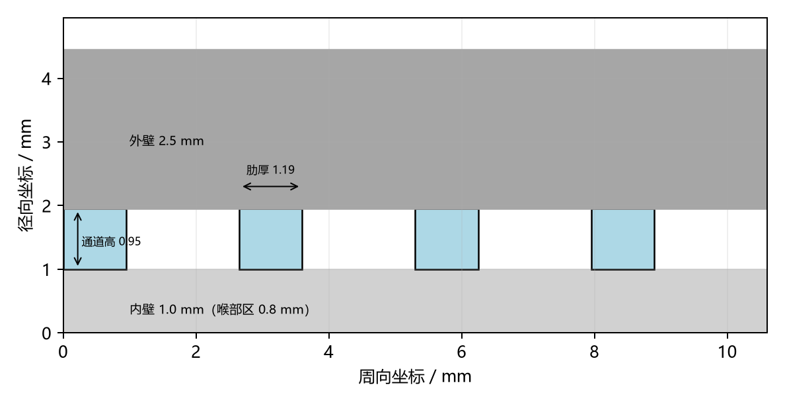{ height="140" } [下载](assets/picture/fig_channel.png) |
| 推力室型面轮廓 | 燃气侧型面轮廓线，标注燃烧室直径 29.97 mm、室长 126.61 mm、扩张段 26.44 mm 与出口直径 26.24 mm。 | 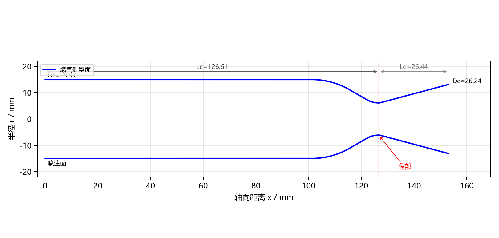{ height="140" } [下载](assets/picture/fig_contour.png) |
| 喷注面布置 | 喷注面正视图，6 组气液互击单元（气氧孔 Ø2.06 与燃料孔 Ø1.14）均布于 Ø16 mm 圆周，外圈为头部气膜孔，并标注喷注面 Ø30 mm。 | 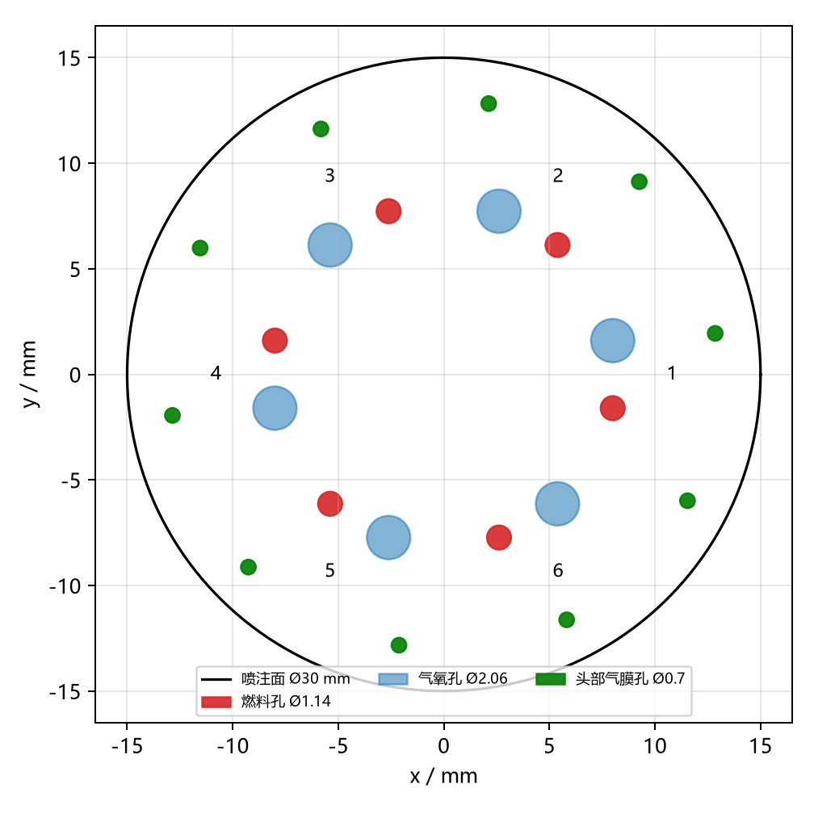{ height="140" } [下载](assets/picture/fig_injector.png) |
| 比冲对比 | RPA 性能柱状图，对比海平面/真空的理想与交付比冲（242.3 / 228.6 / 268.2 / 254.5 s）。 | 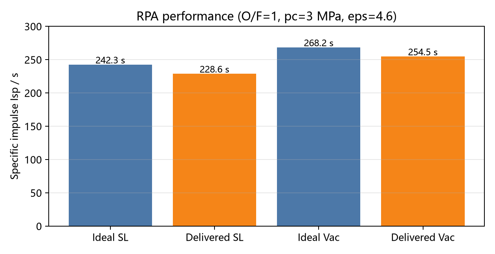{ height="140" } [下载](assets/picture/fig_isp.png) |
| 整机布置剖视 | 纵剖布置图，含头部总长 51 mm、推力室 153.1 mm、两层集液腔、18 条轴向冷却通道与接口位置。 | { height="140" } [下载](assets/picture/fig_layout.png) |
| 氧燃比扫描 | 海平面与真空交付比冲、燃烧室温度随氧燃比的变化曲线，并标出设计点 O/F=1.0。 | 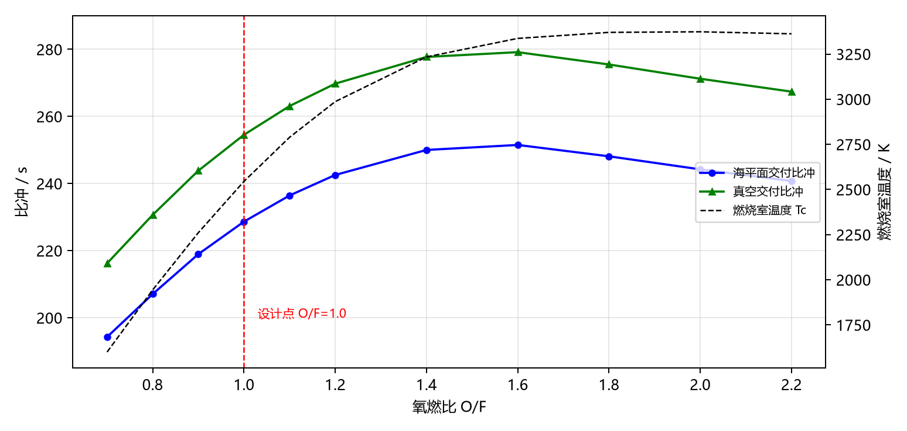{ height="140" } [下载](assets/picture/fig_ofsweep.png) |
| 沿程热流与壁温 | 沿轴向的热流密度、燃气侧壁温、冷却剂侧壁温与冷却剂温度分布，喉部出现峰值。 | 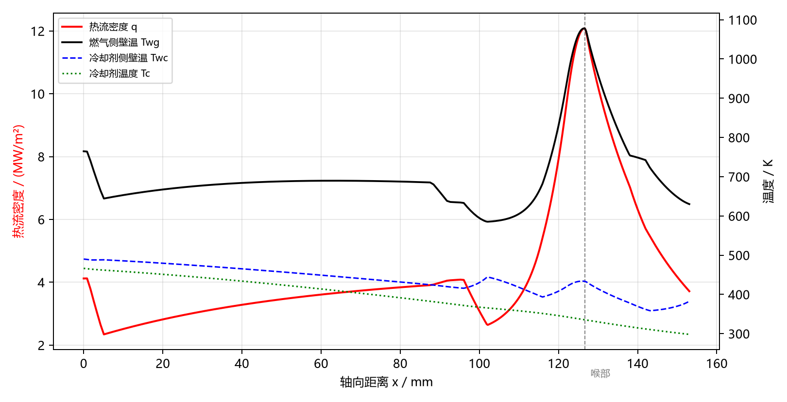{ height="140" } [下载](assets/picture/fig_thermal.png) |
| RPA 发动机定义 | RPA 的 Engine Definition 输入页，记录 500 N 海平面推力、室压 3 MPa、O/F=1.0 与再生冷却方案。 | 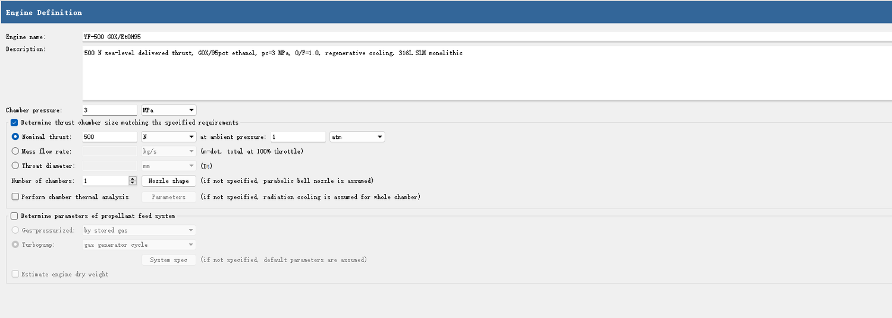{ height="140" } [下载](assets/picture/rpa_1_engine.png) |
| RPA 推进剂规格 | RPA 的推进剂输入页，气相氧 280 K / 3.5 MPa，95% 乙醇 298.15 K / 3.4 MPa。 | 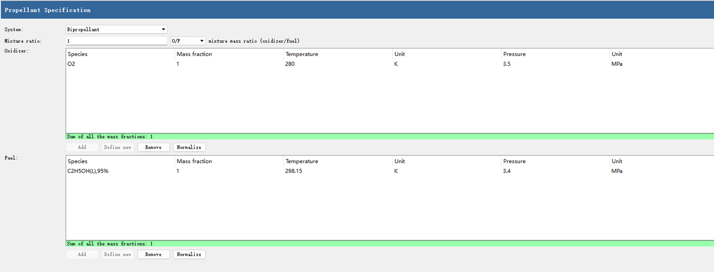{ height="140" } [下载](assets/picture/rpa_2_prop.png) |
| RPA 喷管模型设置 | RPA 的喷管流动设置，收缩比 6、扩张比 4.6，未启用冻结流模型。 | 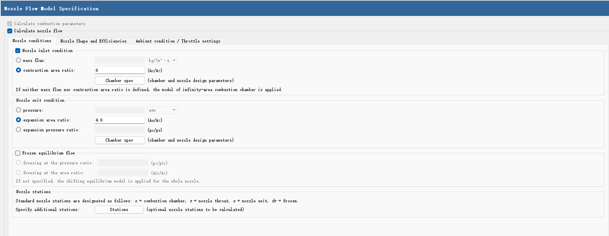{ height="140" } [下载](assets/picture/rpa_3_nozzle.png) |
| RPA 推力室几何 | RPA 计算的推力室尺寸与流量汇总，含真空推力 0.55496 kN、总流量 0.22234 kg/s 及各项几何量。 | 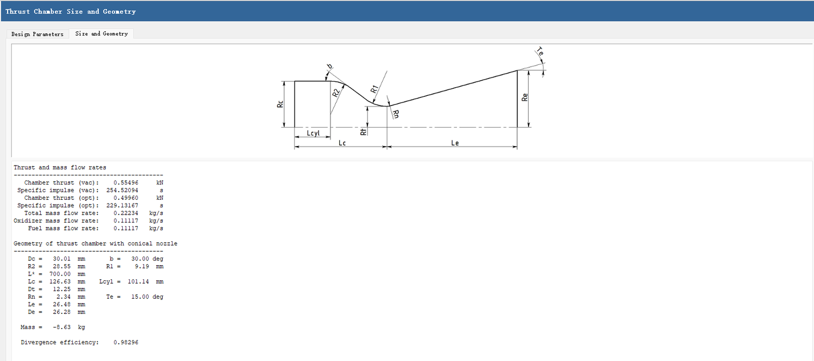{ height="140" } [下载](assets/picture/rpa_4_geom.png) |
| RPA 燃烧室性能 | RPA 的燃烧室性能表，给出喷注器、喉部、出口各站的压力、温度、比热、分子量与马赫数等参数。 | 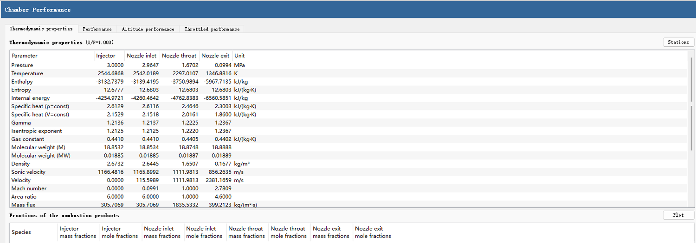{ height="140" } [下载](assets/picture/rpa_5_perf.png) |

## 三维模型

| 格式 | 文件 | 说明 |
| -- | ---- | ---- |
| STEP | [YF-500_engine.step](assets/model/YF-500_engine.step) | AP214 格式，由 Open CASCADE / build123d 导出，可直接再建模或划分网格。 |
| STL | [YF-500_engine.stl](assets/model/YF-500_engine.stl) | 二进制 STL，57930 个三角面，包围盒 90.51 × 90.51 × 203.06 mm（轴向为 Z）。 |
| SLDPRT | [YF-500_engine_SW.SLDPRT](assets/model/YF-500_engine_SW.SLDPRT) | SolidWorks 零件源文件，供参数化修改使用。 |
| STL | [YF-500_engine_SW.stl](assets/model/YF-500_engine_SW.stl) | 由 SolidWorks 导出的二进制 STL，23554 个三角面，包围盒 90.51 × 203.06 × 90.51 mm（轴向为 Y）。 |

## 原始参数记录

| 内容 | 截图 | 下载链接 |
| ---- | ---- | ---- |
| 1 总体参数 | 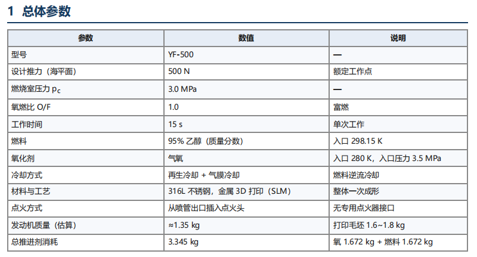{ height="200" } | [下载](assets/picture/param_01.png) |
| 2 性能参数 | 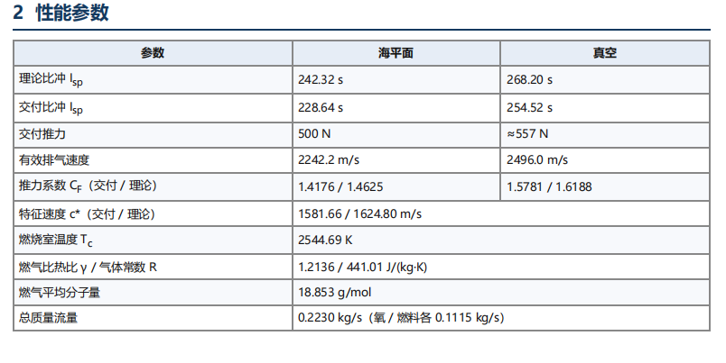{ height="200" } | [下载](assets/picture/param_02.png) |
| 3 推力室与喷管参数 | 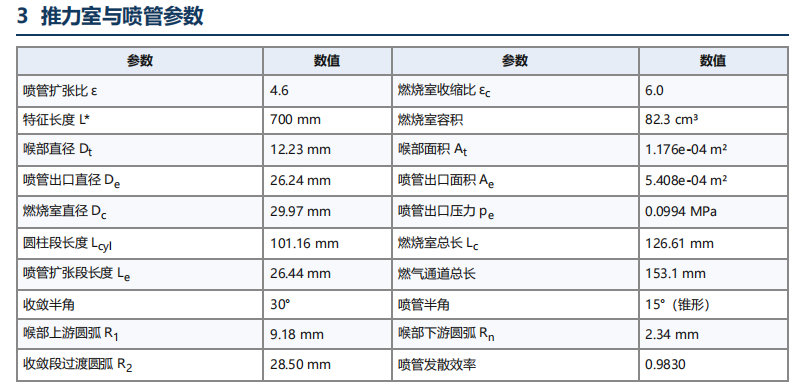{ height="200" } | [下载](assets/picture/param_03.png) |
| 4 喷注器参数 | 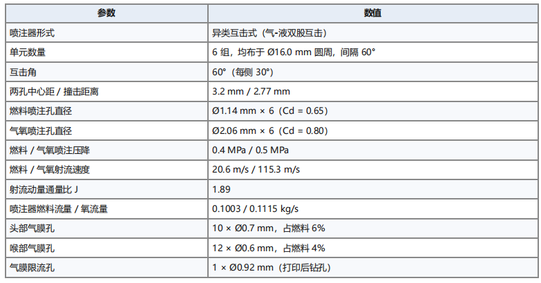{ height="200" } | [下载](assets/picture/param_04.png) |
| 5 再生冷却参数 | 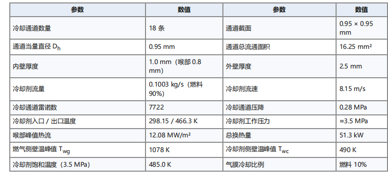{ height="200" } | [下载](assets/picture/param_05.png) |

原始资料中的第 4、5 张截图未包含小标题（标题行已被裁切），本页按表格内容命名。

## 说明

- **数据来源**：本页参数全部转录自 YF-500 V1 的参数表截图，数值、单位、正负号与「≈」「~」等符号均照原文保留，未做换算或修约。
- **AI 整理**：图片与表格由 AI 逐格转录整理，尚未经人工逐项复核；引用前请与原始截图对照。
- **模型格式**：STEP 用于精确几何交换，STL 为三角面近似，SLDPRT 为 SolidWorks 原生零件；两种 STL 的三角面数与坐标轴朝向不同，但包围盒量值一致（90.51 / 203.06 / 90.51 mm 的排列差异），即同一几何的不同导出结果。
