# YF-500 V2

文档AI等级：4

YF-500 V2 是 V1 初始方案的迭代版，型号与版本记为 YF-500 / V2.0，定位为「免后加工、自支撑打印版」。推力、室压、氧燃比、推进剂与工作时间与 V1 相同：海平面设计推力 500 N、燃烧室压力 3.0 MPa、氧燃比 1.0、95% 乙醇 + 气氧、单次工作 15 s，整机仍为 316L 不锈钢 SLM 一体成形。

相对 V1，V2 的可确认变化集中在三处。喷注器由 6 组减为 4 组（均布于 Ø16.0 mm 圆周，间隔 90°），燃料与气氧喷注孔加大到 Ø1.50 mm × 4 与 Ø2.70 mm × 4；气膜冷却比例由燃料的 10% 提到 14.9%（头部 9.5% + 喉部 5.4%），头部气膜孔改为 10 × Ø0.8 mm、喉部 12 × Ø0.7 mm，限流孔改为打印时直接成形、不再钻孔；再生冷却通道截面由 0.95 × 0.95 mm 改为 1.0 × 1.0 mm，内壁加厚至 1.2 mm（喉部 1.1 mm）、外壁 1.8 mm（出口段 2.2 mm）。模型质量 1.63 kg（体积 206.46 cm³），打印毛坯含支撑约 1.75~1.9 kg。

## 总体参数

| 参数 | 数值 | 说明 |
| -- | ---- | ---- |
| 型号 / 版本 | YF-500 / V2.0 | 免后加工、自支撑打印版 |
| 设计推力（海平面） | 500 N | 额定工作点 |
| 燃烧室压力 \(p_c\) | 3.0 MPa | — |
| 氧燃比 O/F | 1.0 | 富燃 |
| 工作时间 | 15 s | 单次工作 |
| 燃料 | 95% 乙醇（质量分数） | 入口 298.15 K |
| 氧化剂 | 气氧 | 入口 280 K，入口压力 3.5 MPa |
| 冷却方式 | 再生冷却 + 气膜冷却 | 燃料逆流冷却 + 头部/喉部气膜 |
| 材料与工艺 | 316L 不锈钢，金属 3D 打印（SLM） | 整体一次成形，免后加工 |
| 点火方式 | 从喷管出口插入点火头 | 无专用点火器接口 |
| 发动机质量（模型） | 1.63 kg | 体积 206.46 cm³（316L，7.9 g/cm³） |
| 打印毛坯质量（含支撑） | ≈1.75~1.9 kg | 支撑/余量按 7%~15% 估 |
| 总推进剂消耗 | 3.345 kg | 氧 1.672 kg + 燃料 1.672 kg |

## 性能参数

| 参数 | 海平面 | 真空 |
| -- | ---- | ---- |
| 理论比冲 \(I_{sp}\) | 242.32 s | 268.20 s |
| 交付比冲 \(I_{sp}\) | 228.64 s | 254.52 s |
| 交付推力 | 500 N | ≈557 N |
| 有效排气速度 | 2242.1 m/s | 2495.9 m/s |
| 推力系数 \(C_F\)（交付 / 理论） | 1.4176 / 1.4625 | 1.5781 / 1.6188 |
| 特征速度 \(c^*\)（交付 / 理论） | 1581.66 / 1624.80 m/s | — |
| 燃烧室温度 \(T_c\) | 2544.69 K | — |
| 燃气比热比 \(\gamma\) / 气体常数 R | 1.2136 / 441.01 J/(kg·K) | — |
| 燃气平均分子量 | 18.853 g/mol | — |
| 总质量流量 | 0.2230 kg/s（氧 / 燃料各 0.1115 kg/s） | — |

「特征速度」及以下五行属燃烧室单一状态量，原表未区分海平面与真空，真空列留空，本表以「—」表示。

## 推力室与喷管参数

| 参数 | 数值 | 参数 | 数值 |
| -- | ---- | -- | ---- |
| 喷管扩张比 \(\varepsilon\) | 4.6 | 燃烧室收缩比 \(\varepsilon_c\) | 6.0 |
| 特征长度 \(L^*\) | 700 mm | 燃烧室容积 | 82.3 cm³ |
| 喉部直径 \(D_t\) | 12.23 mm | 喉部面积 \(A_t\) | 1.176e-04 m² |
| 喷管出口直径 \(D_e\) | 26.24 mm | 喷管出口面积 \(A_e\) | 5.408e-04 m² |
| 燃烧室直径 \(D_c\) | 29.97 mm | 喷管出口压力 \(p_e\) | 0.0994 MPa |
| 圆柱段长度 \(L_{cyl}\) | 101.16 mm | 燃烧室总长 \(L_c\) | 126.61 mm |
| 喷管扩张段长度 \(L_e\) | 26.44 mm | 燃气通道总长 | 153.1 mm |
| 收敛半角 | 30° | 喷管半角 | 15°（锥形） |
| 喉部上游圆弧 \(R_1\) | 9.18 mm | 喉部下游圆弧 \(R_n\) | 2.34 mm |
| 收敛段过渡圆弧 \(R_2\) | 28.50 mm | 喷管发散效率 | 0.9830 |

原表按左右两栏并排排版，左右两栏各自独立排列，同一行左右两项之间没有对应关系；本表保留原分栏顺序。V2 本节的数值与 V1 完全一致，说明该版本未改推力室与喷管型面。

## 喷注器参数

| 参数 | 数值 | 参数 | 数值 |
| -- | ---- | -- | ---- |
| 喷注器形式 | 异类互击式（气-液双股互击） | 单元数量 | 4 组，均布于 Ø16.0 mm 圆周，间隔 90° |
| 互击角 | 60°（每侧 30°） | 两孔中心距 / 撞击距离 | 3.2 mm / 2.77 mm |
| 燃料喷注孔直径 | Ø1.50 mm × 4（Cd = 0.65） | 气氧喷注孔直径 | Ø2.70 mm × 4（Cd = 0.80） |
| 燃料 / 气氧喷注压降（设计值） | 0.4 MPa / 0.5 MPa | 采用孔径对应压降 | 0.27 MPa / 0.39 MPa |
| 燃料 / 气氧射流速度 | 20.6 m/s / 115.3 m/s | 射流动量通量比 J | 1.89 |
| 喷注器燃料流量 / 氧流量 | 0.0949 / 0.1115 kg/s | 冷却剂（燃料）流量 | 0.0949 kg/s |
| 打印公差（±0.25 mm）下流量面积误差 | 燃料 -31% ~ +36% | 氧 | -18% ~ +19% |
| 头部气膜孔 | 10 × Ø0.8 mm，占燃料 9.5% | 喉部气膜孔 | 12 × Ø0.7 mm，占燃料 5.4% |
| 气膜限流孔 | 头部 1 × Ø0.9 mm、喉部 1 × Ø0.7 mm（均直接打印，不钻孔） | | |

原表按左右两栏并排排版，本表保留原分栏顺序；最后一行跨栏，右栏为空。

## 再生冷却参数

| 参数 | 数值 | 参数 | 数值 |
| -- | ---- | -- | ---- |
| 冷却通道数量 | 18 条 | 通道截面 | 1.0 × 1.0 mm（喉部宽 1.0 mm） |
| 通道当量直径 \(D_h\) | 1.23 mm | 通道总流通面积 | 28.5 mm²（平均） |
| 内壁厚度 | 1.2 mm（喉部 1.1 mm） | 中壁 / 外层集液环 | 1.2 mm / 1.0 mm |
| 外壁厚度 | 1.8 mm（出口段 2.2 mm） | 冷却方式 | 逆流再生冷却（燃料） |
| 冷却剂流量 | 0.0949 kg/s（燃料 85.1%） | 冷却剂流速 | 4.33 m/s |
| 冷却通道雷诺数 | 4770 | 冷却通道压降 | 0.064 MPa |
| 冷却剂入口 / 出口温度 | 298.15 / 456 K | 冷却剂工作压力 | ≈3.5 MPa |
| 喉部峰值热流 | 10.2 MW/m² | 总换热量 | ≈46.5 kW |
| 燃气侧壁温峰值 \(T_{wg}\) | ≈1170 K | 冷却剂侧壁温峰值 \(T_{wc}\) | 508 K |
| 冷却剂饱和温度（3.5 MPa） | 485.0 K | 气膜冷却比例 | 燃料 14.9%（头部 9.5% + 喉部 5.4%） |

原表数据存在一处不自洽：按「18 条 × 1.0 × 1.0 mm」计，总流通面积应为 18 mm²，而表列为 28.5 mm²（平均）；正方形截面 1.0 × 1.0 mm 的当量直径应为 1.0 mm，而表列为 1.23 mm。截图文字清晰，矛盾出在原始数据本身，待核。

## 仿真与设计图表

| 图表 | 说明 | 文件 |
| ---- | ---- | ---- |
| 圆度拟合（V1 对照） | 对 V1 几何四个关键回转特征做圆度拟合：喷管出口外圆 R=18.371 mm、内圆 R=12.711 mm、喉部外圆 R=12.519 mm、头部外圆 R=39.984 mm，椭圆度不超过 0.008%。 | 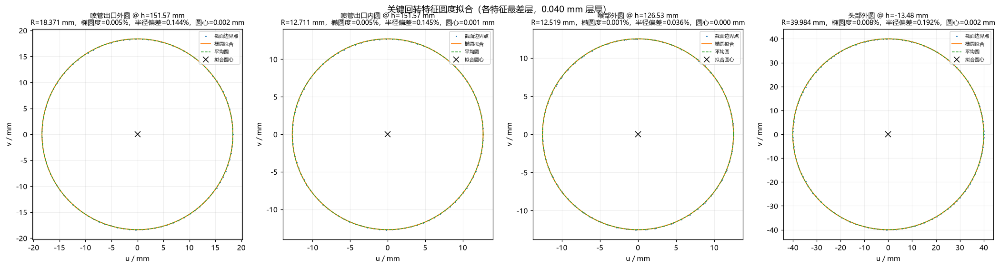{ height="140" } [下载](assets/picture/V1_fig_circle_fit.png) |
| 逐层截面与质心漂移（V1 对照） | V1 几何按 0.040 mm 层厚逐层切片，给出截面积、外轮廓圆心偏移（峰值约 0.0022 mm）与层间错位指标。 | 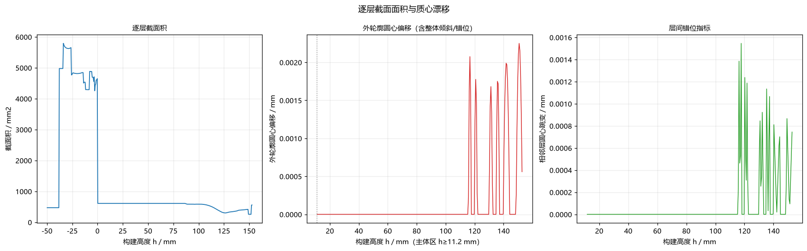{ height="140" } [下载](assets/picture/V1_fig_layer_profile.png) |
| 悬垂与支撑（V1 对照） | V1 几何沿构建方向 [0, 0.1] 的悬垂分布：需支撑面积 6847.2 mm²（5.76%），内部/窄缝 169.5 mm²，被遮挡 1412.3 mm²。 | 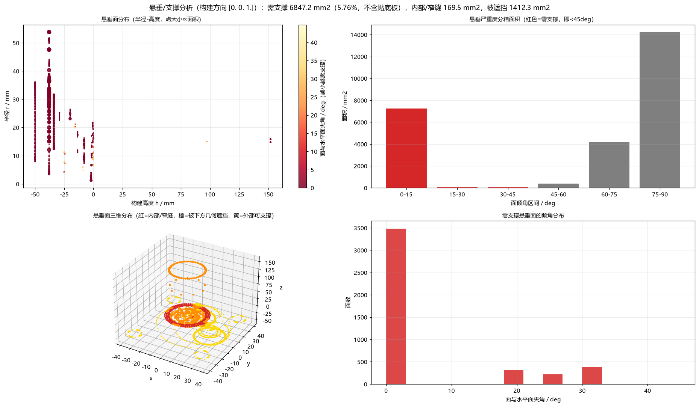{ height="140" } [下载](assets/picture/V1_fig_overhang.png) |
| 体素切片（V1 对照） | V1 几何四个高度的体素切片，灰为实体、白为连通空气，青色点为封闭空腔探测的种子点，用于核查各内腔与外部是否连通。 | 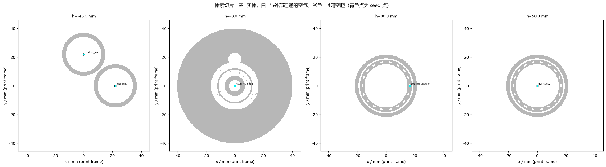{ height="140" } [下载](assets/picture/V1_fig_voxel_slices.png) |
| 壁厚分布（V1 对照） | V1 几何 15000 个采样点的局部壁厚直方图，P1=0.78 mm、P5=1.00 mm、P50=2.50 mm，虚线标出 0.8 mm 与 1.0 mm。 | 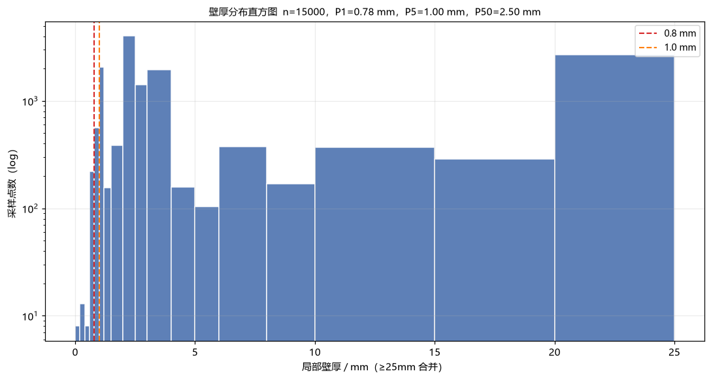{ height="140" } [下载](assets/picture/V1_fig_wall_hist.png) |
| 薄壁位置（V1 对照） | V1 几何壁厚小于 1.0 mm 的位置分布（深红为小于 0.8 mm），叠加在全部采样点上用于定位打印薄弱区。 | 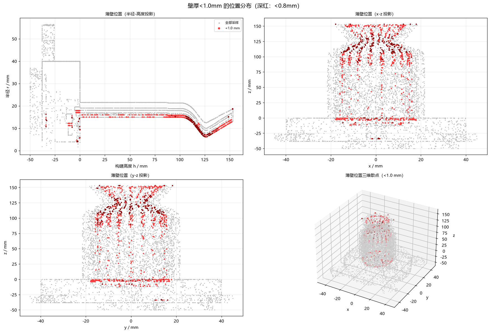{ height="140" } [下载](assets/picture/V1_fig_wall_thin.png) |
| 圆度拟合（V2） | V2 几何四个关键回转特征的拟合：喷管出口外圆 R=19.136 mm、内圆 R=13.117 mm、喉部外圆 R=12.226 mm、头部外圆 R=51.974 mm，椭圆度不超过 0.001%。 | 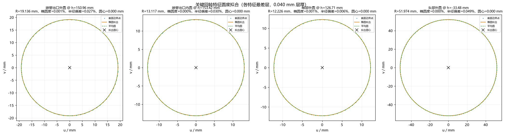{ height="140" } [下载](assets/picture/V2_fig_circle_fit.png) |
| 逐层截面与质心漂移（V2） | V2 几何逐层截面积曲线，外轮廓圆心偏移峰值约 0.0009 mm，层间错位小于 0.0008 mm。 | 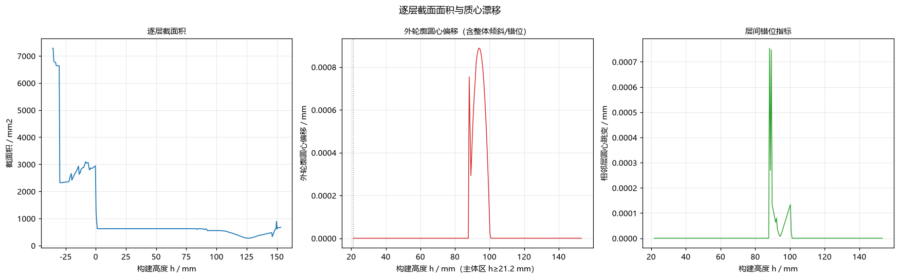{ height="140" } [下载](assets/picture/V2_fig_layer_profile.png) |
| 悬垂与支撑（V2） | V2 几何的悬垂统计：需支撑面积 2552.3 mm²（2.00%），内部/窄缝 1050.4 mm²，被遮挡 2459.4 mm²。 | 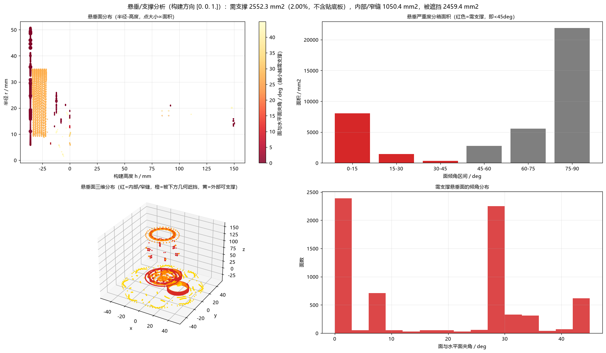{ height="140" } [下载](assets/picture/V2_fig_overhang.png) |
| 体素切片（V2） | V2 几何的体素切片，检查头部集液腔、冷却通道与燃气腔在各高度截面上的连通性。 | 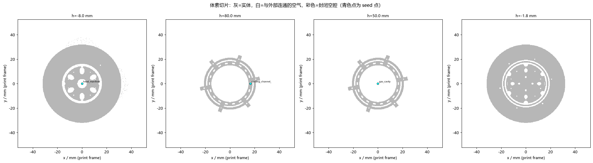{ height="140" } [下载](assets/picture/V2_fig_voxel_slices.png) |
| 壁厚分布（V2） | V2 几何 15000 个采样点的壁厚直方图，P1=0.44 mm、P5=1.03 mm、P50=2.58 mm。 | { height="140" } [下载](assets/picture/V2_fig_wall_hist.png) |
| 薄壁位置（V2） | V2 几何壁厚小于 1.0 mm 的位置分布（深红为小于 0.8 mm），三个投影面加三维散点同时给出。 | 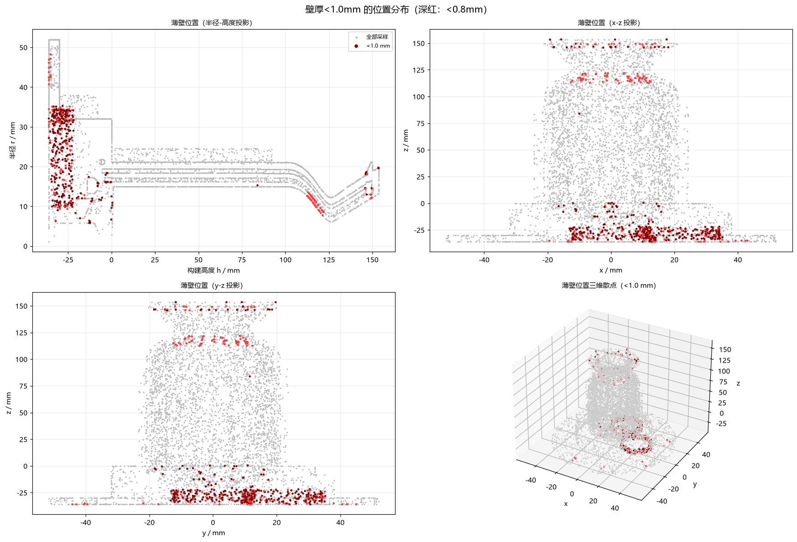{ height="140" } [下载](assets/picture/V2_fig_wall_thin.png) |
| 圆度拟合（V2 final3） | 迭代编号 final3 的几何圆度拟合：喷管出口外圆 R=18.829 mm、内圆 R=13.117 mm、喉部外圆 R=11.929 mm、头部外圆 R=51.974 mm。 | 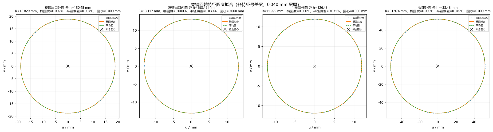{ height="140" } [下载](assets/picture/V2_final3_fig_circle_fit.png) |
| 逐层截面与质心漂移（V2 final3） | 该版本逐层截面积与质心漂移曲线，外轮廓圆心偏移峰值约 0.0009 mm。 | 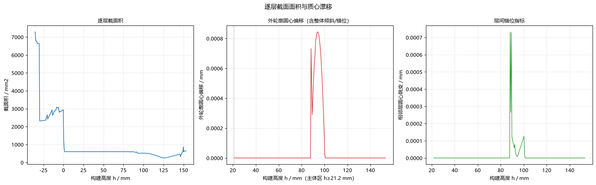{ height="140" } [下载](assets/picture/V2_final3_fig_layer_profile.png) |
| 悬垂与支撑（V2 final3） | 该版本需支撑面积 2562.9 mm²（2.01%），内部/窄缝 1069.3 mm²，被遮挡 2467.6 mm²。 | 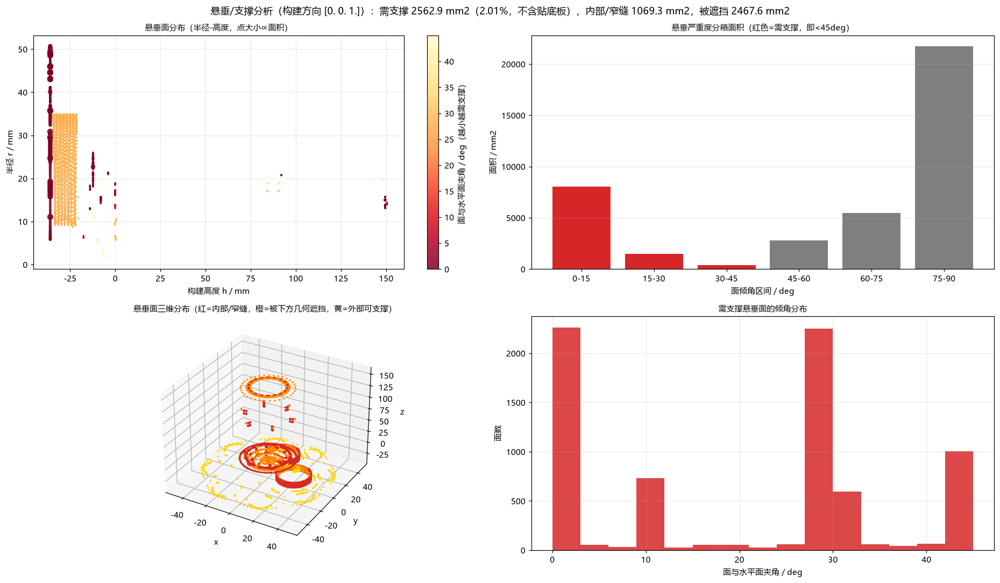{ height="140" } [下载](assets/picture/V2_final3_fig_overhang.png) |
| 体素切片（V2 final3） | 该版本四个特征高度的体素切片，用于核对集液腔与冷却通道的连通与封闭空腔。 | { height="140" } [下载](assets/picture/V2_final3_fig_voxel_slices.png) |
| 壁厚分布（V2 final3） | 该版本壁厚直方图（n=15000），P1=0.41 mm、P5=0.95 mm、P50=2.57 mm。 | 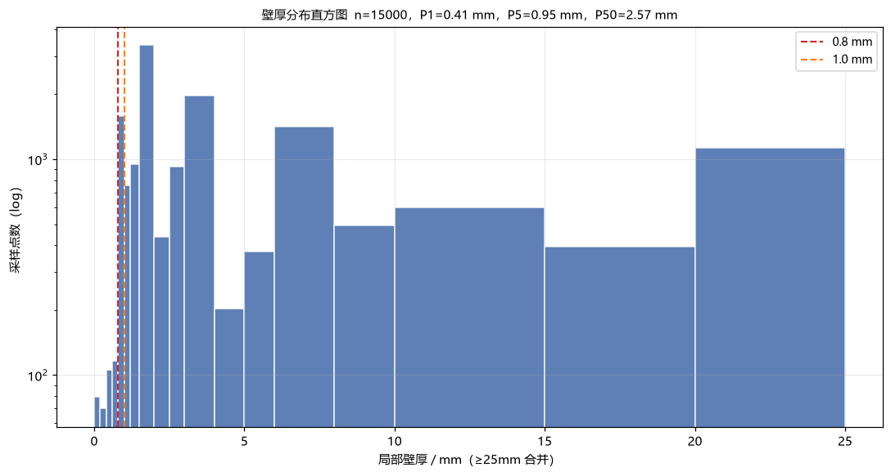{ height="140" } [下载](assets/picture/V2_final3_fig_wall_hist.png) |
| 薄壁位置（V2 final3） | 该版本壁厚小于 1.0 mm 的位置分布，四个视图分别为半径-高度、x-z、y-z 投影与三维散点。 | 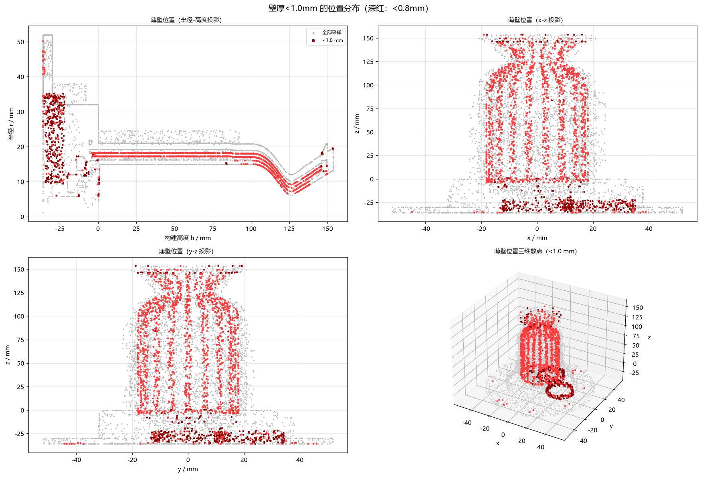{ height="140" } [下载](assets/picture/V2_final3_fig_wall_thin.png) |

文件名前缀对应被分析的几何：`V1_` 为对 V1 几何做的对照分析，`V2_` 为 V2 首版几何，`V2_final3_` 为同批分析中迭代编号 final3 的结果（编号含义待核）。三组图均属打印可制造性分析，与 V1 页的热力/性能仿真图不同。

## 三维模型

| 格式 | 文件 | 说明 |
| -- | ---- | ---- |
| STEP | [YF-500_V2.step](assets/model/YF-500_V2.step) | AP214 格式，由 Open CASCADE / build123d 导出，可直接再建模或划分网格。 |
| STL | [YF-500_V2.stl](assets/model/YF-500_V2.stl) | 二进制 STL，62212 个三角面，包围盒 104.0 × 103.9 × 189.5 mm。 |
| STL | [YF-500_V2_print.stl](assets/model/YF-500_V2_print.stl) | 打印定向导出的二进制 STL，62210 个三角面，包围盒与上一文件一致。 |

## 原始参数记录

| 内容 | 截图 | 下载链接 |
| ---- | ---- | ---- |
| 1 总体参数 | 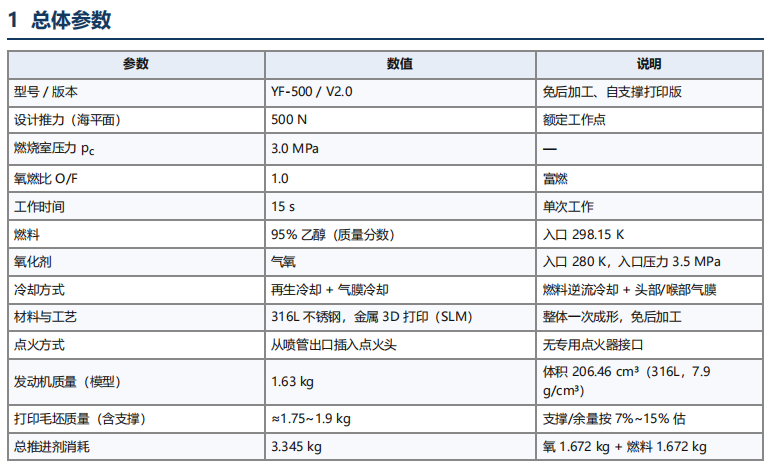{ height="200" } | [下载](assets/picture/param_01.png) |
| 2 性能参数 | 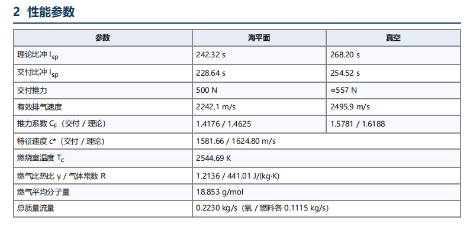{ height="200" } | [下载](assets/picture/param_02.png) |
| 3 推力室与喷管参数 | 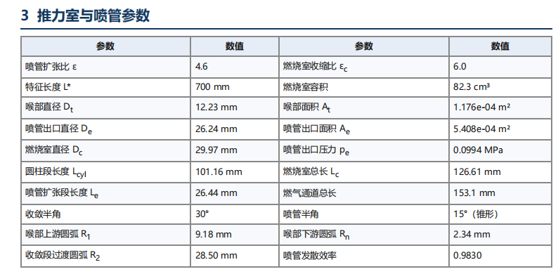{ height="200" } | [下载](assets/picture/param_03.png) |
| 4 喷注器参数 | 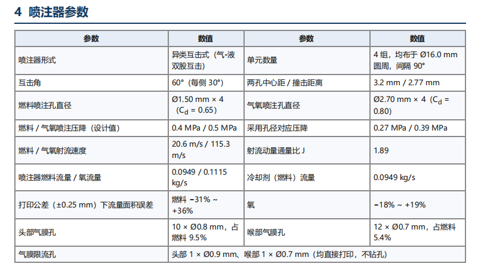{ height="200" } | [下载](assets/picture/param_04.png) |
| 5 再生冷却参数 | 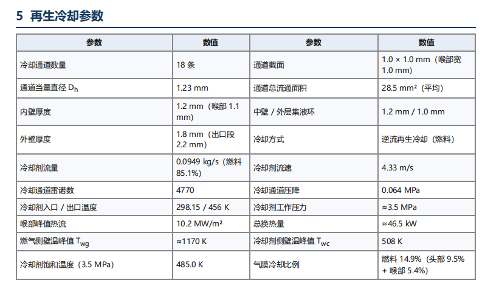{ height="200" } | [下载](assets/picture/param_05.png) |

## 说明

- **数据来源**：本页参数全部转录自 YF-500 V2 的参数表截图，数值、单位、正负号与「≈」「~」等符号均照原文保留，未做换算或修约。
- **AI 整理**：图片与表格由 AI 逐格转录整理，尚未经人工逐项复核；引用前请与原始截图对照。图表说明中的数值取自图内标注，表格数值取自参数表，两者口径不同。
- **模型格式**：STEP 用于精确几何交换，STL 为三角面近似，`YF-500_V2_print.stl` 为打印定向版本，与本页打印工艺分析图对应。
