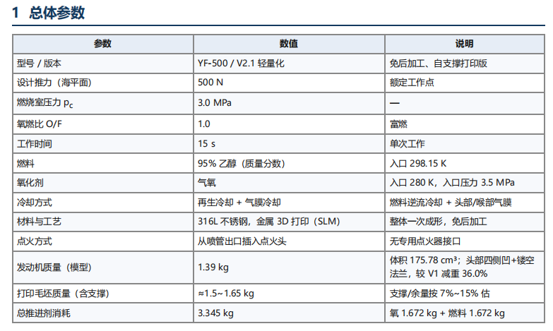
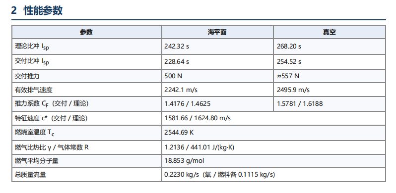
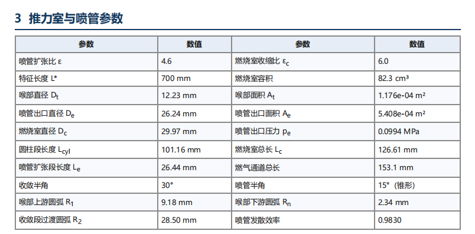
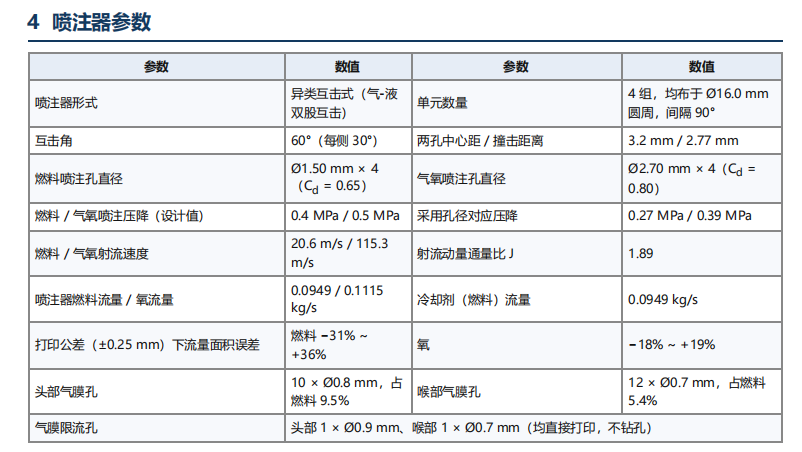
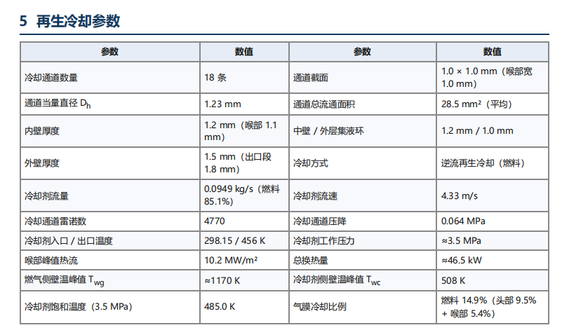

# YF-500 V2.1

文档AI等级：4

YF-500 为 500 N 级气氧 / 95% 乙醇再生冷却液体火箭发动机。V2.1 是其中的轻量化方案，采用 316L 不锈钢激光选区熔化（SLM）整体一次成形，以"免后加工、自支撑打印版"为设计目标：通过头部四侧凹与镂空法兰把模型质量压到 1.39 kg，体积 175.78 cm³，较 V1 减重 36.0%。推进剂为气氧与 95% 乙醇（质量分数），氧燃比 1.0，燃烧室压力 3.0 MPa，海平面设计推力 500 N，单次工作时间 15 s；冷却为燃料逆流再生冷却加头部 / 喉部气膜冷却。

本页参数均逐格转录自 V2.1 参数截图，数值与单位按原表面貌保留，未做二次换算或修正；喷注器互击部分摘录自同期 CFD 长时统计报告，只记录报告明确写出的内容。V2.1 沿用 V2 参数基线——版本目录下的图表截图与 V2 参数截图逐字节相同（SHA-256 一致），故本页不重复收录该组截图。

## 总体参数

| 参数 | 数值 | 说明 |
| --- | --- | --- |
| 型号 / 版本 | YF-500 / V2.1 轻量化 | 免后加工、自支撑打印版 |
| 设计推力（海平面） | 500 N | 额定工作点 |
| 燃烧室压力 p_c | 3.0 MPa | — |
| 氧燃比 O/F | 1.0 | 富燃 |
| 工作时间 | 15 s | 单次工作 |
| 燃料 | 95% 乙醇（质量分数） | 入口 298.15 K |
| 氧化剂 | 气氧 | 入口 280 K，入口压力 3.5 MPa |
| 冷却方式 | 再生冷却 + 气膜冷却 | 燃料逆流冷却 + 头部 / 喉部气膜 |
| 材料与工艺 | 316L 不锈钢，金属 3D 打印（SLM） | 整体一次成形，免后加工 |
| 点火方式 | 从喷管出口插入点火头 | 无专用点火器接口 |
| 发动机质量（模型） | 1.39 kg | 体积 175.78 cm³；头部四侧凹 + 镂空法兰，较 V1 减重 36.0% |
| 打印毛坯质量（含支撑） | ≈1.5~1.65 kg | 支撑 / 余量按 7%~15% 估 |
| 总推进剂消耗 | 3.345 kg | 氧 1.672 kg + 燃料 1.672 kg |

## 性能参数

| 参数 | 海平面 | 真空 |
| --- | --- | --- |
| 理论比冲 I_sp | 242.32 s | 268.20 s |
| 交付比冲 I_sp | 228.64 s | 254.52 s |
| 交付推力 | 500 N | ≈557 N |
| 有效排气速度 | 2242.1 m/s | 2495.9 m/s |
| 推力系数 C_F（交付 / 理论） | 1.4176 / 1.4625 | 1.5781 / 1.6188 |
| 特征速度 c*（交付 / 理论） | 1581.66 / 1624.80 m/s | （同左） |
| 燃烧室温度 T_c | 2544.69 K | （同左） |
| 燃气比热比 γ / 气体常数 R | 1.2136 / 441.01 J/(kg·K) | （同左） |
| 燃气平均分子量 | 18.853 g/mol | （同左） |
| 总质量流量 | 0.2230 kg/s（氧 / 燃料各 0.1115 kg/s） | （同左） |

## 推力室与喷管参数

| 参数 | 数值 | 参数 | 数值 |
| --- | --- | --- | --- |
| 喷管扩张比 ε | 4.6 | 燃烧室收缩比 ε_c | 6.0 |
| 特征长度 L* | 700 mm | 燃烧室容积 | 82.3 cm³ |
| 喉部直径 D_t | 12.23 mm | 喉部面积 A_t | 1.176e-04 m² |
| 喷管出口直径 D_e | 26.24 mm | 喷管出口面积 A_e | 5.408e-04 m² |
| 燃烧室直径 D_c | 29.97 mm | 喷管出口压力 P_e | 0.0994 MPa |
| 圆柱段长度 L_cyl | 101.16 mm | 燃烧室总长 L_c | 126.61 mm |
| 喷管扩张段长度 L_e | 26.44 mm | 燃气通道总长 | 153.1 mm |
| 收敛半角 | 30° | 喷管半角 | 15°（锥形） |
| 喉部上游圆弧 R_1 | 9.18 mm | 喉部下游圆弧 R_n | 2.34 mm |
| 收敛段过渡圆弧 R_2 | 28.50 mm | 喷管发散效率 | 0.9830 |

## 喷注器参数

| 参数 | 数值 | 参数 | 数值 |
| --- | --- | --- | --- |
| 喷注器形式 | 异类互击式（气-液双股互击） | 单元数量 | 4 组，均布于 Ø16.0 mm 圆周，间隔 90° |
| 互击角 | 60°（每侧 30°） | 两孔中心距 / 撞击距离 | 3.2 mm / 2.77 mm |
| 燃料喷注孔直径 | Ø1.50 mm × 4（C_d = 0.65） | 气氧喷注孔直径 | Ø2.70 mm × 4（C_d = 0.80） |
| 燃料 / 气氧喷注压降（设计值） | 0.4 MPa / 0.5 MPa | 采用孔径对应压降 | 0.27 MPa / 0.39 MPa |
| 燃料 / 气氧射流速度 | 20.6 m/s / 115.3 m/s | 射流动量通量比 J | 1.89 |
| 喷注器燃料流量 / 氧流量 | 0.0949 / 0.1115 kg/s | 冷却剂（燃料）流量 | 0.0949 kg/s |
| 打印公差（±0.25 mm）下流量面积误差 | 燃料 -31% ~ +36% | 氧 | -18% ~ +19% |
| 头部气膜孔 | 10 × Ø0.8 mm，占燃料 9.5% | 喉部气膜孔 | 12 × Ø0.7 mm，占燃料 5.4% |
| 气膜限流孔 | 头部 1 × Ø0.9 mm，喉部 1 × Ø0.7 mm（均直接打印，不钻孔） | | |

注：末行"气膜限流孔"在原截图中为跨列合并单元格，此处按左对齐转录。

## 再生冷却参数

| 参数 | 数值 | 参数 | 数值 |
| --- | --- | --- | --- |
| 冷却通道数量 | 18 条 | 通道截面 | 1.0 × 1.0 mm（喉部宽 1.0 mm） |
| 通道当量直径 D_h | 1.23 mm | 通道总流通面积 | 28.5 mm²（平均） |
| 内壁厚度 | 1.2 mm（喉部 1.1 mm） | 中壁 / 外层集液环 | 1.2 mm / 1.0 mm |
| 外壁厚度 | 1.5 mm（出口段 1.8 mm） | 冷却方式 | 逆流再生冷却（燃料） |
| 冷却剂流量 | 0.0949 kg/s（燃料 85.1%） | 冷却剂流速 | 4.33 m/s |
| 冷却通道雷诺数 | 4770 | 冷却通道压降 | 0.064 MPa |
| 冷却剂入口 / 出口温度 | 298.15 / 456 K | 冷却剂工作压力 | ≈3.5 MPa |
| 喉部峰值热流 | 10.2 MW/m² | 总换热量 | ≈46.5 kW |
| 燃气侧壁温峰值 T_wg | ≈1170 K | 冷却剂侧壁温峰值 T_wc | 508 K |
| 冷却剂饱和温度（3.5 MPa） | 485.0 K | 气膜冷却比例 | 燃料 14.9%（头部 9.5% + 喉部 5.4%） |

## 喷注器互击仿真

仿真对象为 V2.1 轻量化方案的异类互击喷注单元。受算例规模限制，计算域取 1/4 燃烧室扇形域（90°，含 1 个完整互击单元）：扇形以单元径向-轴向平面为中面、两侧为对称面，径向 0≤r≤15 mm（燃烧室壁），轴向 z=0（喷注面）至 z=16 mm（出口），两个喷注孔沿孔轴向上游延伸 2.0 mm 作为入口直段。报告目的是复现液-气互击过程、给出互击位置与液膜 / 液扇的一次雾化形态，并校核设计喷注参数在工作压力下的流场响应。

### 工况与边界条件

| 项目 | 内容 |
| --- | --- |
| 软件 / 网格 | ANSYS Workbench 2022 R1、Fluent 2022 R1（v221，3ddp）；526,249 个四面体单元，88,445 节点，计算域体积 2842.42 mm³；喷注孔与互击区最小尺寸 0.105~0.13 mm，远场 1.10 mm；minSICN 最小 / 平均 0.336 / 0.801 |
| 求解器 | 3D 双精度、压力基、瞬态（一阶隐式），12 进程并行 |
| 多相模型 | VOF，隐式格式，界面重构 Compressive；phase-1 = 95% 乙醇（液），phase-2 = 气氧（气） |
| 湍流 / 表面张力 | Realizable k-ε + 标准壁面函数；CSF 连续表面力，σ = 0.0228 N/m，无壁面粘附 |
| 工作压力 | 3.0 MPa（燃烧室工作压力） |
| 能量方程 | 关闭（等温冷态，物性按 280~298 K 取值） |
| 时间步长 / 内迭代 | 1.5 µs / 3 次（长时算例） |
| 对流格式 | 动量二阶迎风，压力 PRESTO!，VOF Compressive，k/ε 一阶迎风 |
| 入口边界 | inlet_fuel（Ø1.50）：velocity-inlet，20.6 m/s，方向 (sin30, 0, cos30)，液相体积分数 1；inlet_ox（Ø2.70）：velocity-inlet，115.3 m/s，方向 (−sin30, 0, cos30)，气相 |
| 出口边界 | outlet（z=16 mm）：pressure-outlet，表压 0（绝对 3.0 MPa），回流液相分数 0 |
| 壁面 / 对称面 | inj_face、chamber_wall、hole_fuel、hole_ox 均无滑移、绝热；sym_a / sym_b 为 90° 扇区两侧对称面 |
| 介质物性 | 燃料（95% 乙醇，298 K）805 kg/m³、1.1e-03 Pa·s；气氧（3.47 MPa，280 K）47.66 kg/m³、2.0e-05 Pa·s；σ = 0.0228 N/m |
| 无量纲参数 | J = 1.85（设计值 1.89）；We_l = 22,474，We_g = 28,120；Re_l = 22,613，Re_g = 741,852 |
| 计算时长 | 3.60 ms 物理时间，80 帧（每 45 µs 一帧） |

### 关键结论

- **射流建立与互击位置**：燃料液相以 20.6 m/s 沿 30° 斜孔射入，气氧以 115.3 m/s 反向倾斜射入，两股射流在距喷注面 2.77 mm、半径 r≈8 mm 处交汇；计算给出的射流轴线位置与互击点同设计几何一致，说明斜孔与入口速度方向设置正确。
- **一次雾化形态**：气氧射流动量通量约为液相的 1.9 倍（J≈1.86），互击后液相被气相剪切、展宽为扇形液膜，液膜在气流剪切与表面张力共同作用下失稳、破碎为液丝与液滴。受网格尺度（0.105~0.13 mm）与时间步（1 µs）限制，可分辨的破碎尺度约为 0.2~0.3 mm，更细的二次雾化与液滴尺寸分布需更高分辨率或 DPM / 欧拉-拉格朗日方法。
- **扇面形态**：周向最大投影显示液相互击后沿周向明显展宽，形成液扇足迹；液扇偏向动量较小的一侧，即燃料侧，其扩散半角与 J 及孔径比的组合关系与文献中异类互击喷注的一般规律一致。
- **长时统计（统计窗口 t≥1.0 ms，58 帧）**：域内液相总量 66.1 ± 17.1 mm³；离散液滴数（0.15~0.8 mm）12.3 ± 7.5 个；液滴 D10 225 ± 41 µm、D32（SMD）274 ± 97 µm、D43 298 ± 118 µm、最大液滴当量直径 368 ± 141 µm；液相前锋 z99 2.43 ± 1.52 mm；液膜 / 液丝最大轴向延伸 2.94 ± 1.52 mm；液扇周向展宽（2×y99）6.21 ± 0.52 mm；液扇扩散半角 55.4 ± 16.1°；液相速度中位数 16.2 ± 4.4 m/s；液滴所占液相体积份额 0.9% ± 1.2%。
- **液滴判定口径**：连通液相体按体积等效为球，等效直径 D = (6V/π)^(1/3)；D ∈ [0.15, 0.8] mm 记为离散液滴，D > 0.8 mm 视为连续液膜 / 液丝，0.15 mm 以下受网格分辨率限制不作统计。液滴体积份额较小说明窗口内液相仍以连续液膜 / 液丝为主，离散液滴由液膜前缘剥离形成并被气氧射流带向下游；D32 的数值水平主要由网格可分辨尺度决定，仅用于本算例内部相对比较与趋势判断。
- **时均场**：因两股射流互击位置存在周期性摆动、液膜前缘间歇剥离，时均液相分数场比瞬时场更平滑；液相分数脉动 RMS 的高值区集中在互击点下游 0~6 mm 与液扇边缘，该区域是雾化最剧烈、湍流与界面耦合最强的位置。
- **与设计值的对照**：撞击距离与互击角几何精确实现（3.2 mm 孔距、60° 互击角、30° 倾角）；动量通量比设计 1.89，本算例按同一密度基准得 1.86（差 1.6%）；入口以速度入口 + 工作压力 3.0 MPa 表征，未计入供应管路 / 集合腔的压降与流量分配，如需评估压降与流量分配应建立含集合腔与全部 4 个单元的整机模型。
- **局限性**：计算域为 1/4 扇区单单元，未计入 4 个单元液扇之间的相互干扰；未考虑燃烧、蒸发、传热与壁面热负荷；湍流采用 URANS，对小尺度湍流与界面破碎解析能力有限；液相体积分数 0.5 等值面对应的"表观"液膜厚度属数值量，不宜直接作为真实液膜厚度。

报告下载：[YF-500_V2.1_injector_impingement_simulation.docx](assets/report/YF-500_V2.1_injector_impingement_simulation.docx)

## 仿真与图表

本版未单独发布图表文件，V2.1 沿用 V2 参数基线，版本目录下的 5 张图表截图与 V2 参数截图逐字节相同，因此不再重复收录。下列图像均为上述互击仿真报告的内嵌图，随报告文件一并提供。

| 图表 | 说明 | 文件 |
| --- | --- | --- |
| 图 1（帧 1/80） | t = 0.05 ms 时刻的互击流场：左为撞击面切片 y≈0（x–z 平面），右为周向最大投影（扇面足迹）。此时燃料液相刚从 30° 斜孔进入燃烧室，尚未与气氧射流形成稳定液扇；图中同时给出液相速度标尺，淡青色为气氧射流 | 报告内嵌图 1 |
| 图 41（帧 41/80） | t = 1.84 ms 时刻：互击点已建立，液相在互击后展宽为液膜并向下游偏转，液滴群随气氧射流向出口扩散，扇面足迹清晰可辨 | 报告内嵌图 2 |
| 图 80（帧 80/80） | t = 3.60 ms 时刻（计算终了）：液扇充分展开，液膜前缘剥离形成的液滴充满下游空间，周向投影显示明显的液扇包络 | 报告内嵌图 3 |
| 图 5 长时雾化统计时间序列 | 四联图：(a) 计算域内液相总量随 t 单调累积后趋于饱和；(b) 离散液滴数目在 1000~1700 µs 与 2800~3200 µs 出现两个峰群；(c) 液滴平均当量直径 D32（SMD）与 D10 随时间脉动，D32 峰值明显高于 D10；(d) 液相前锋 z99 与扇面张角随时间呈周期性起伏 | 报告内嵌图 4 |
| 图 6 液滴尺寸分布 | 全时段累计统计：(a) 按当量直径区间计数的柱状分布，150~200 µm 与 200~300 µm 两区间占绝大多数，300 µm 以上迅速减少；(b) 累积数目分布曲线，200 µm 处累积份额约五成，300 µm 处已超过九成 | 报告内嵌图 5 |
| 图 7 时均雾化场 | y≈0 切片：(a) 58 帧平均的时均液相体积分数场；(b) 液相分数脉动 RMS 场。RMS 高值区位于互击点下游与液扇边缘，与"雾化最剧烈区域"的判断一致 | 报告内嵌图 6 |

## 三维模型

| 格式 | 文件 | 说明 |
| --- | --- | --- |
| STEP（AP214） | [YF-500_V2.1_LW.step](assets/model/YF-500_V2.1_LW.step) | 由 Open CASCADE / build123d 导出的实体交换模型，可用于重新导入 CAD、修改与再切片；文件约 8.4 MB |
| STL（二进制） | [YF-500_V2.1_LW.stl](assets/model/YF-500_V2.1_LW.stl) | 62,890 个三角面的网格模型，单位 mm，包围盒 101.73 × 101.73 × 189.50 mm；供渲染、装配占位与切片预览 |
| STL（二进制，打印版） | [YF-500_V2.1_LW_print.stl](assets/model/YF-500_V2.1_LW_print.stl) | 62,888 个三角面，与 .stl 仅差 2 个面、包围盒一致，文件名后缀 _print 表明为切片打印交付用的版本 |

## 原始参数记录

参数截图原样收录，供逐格核对。下表缩略图即上文五张参数表的原始依据。

| 缩略图 | 内容 | 文件 |
| --- | --- | --- |
|  | 总体参数（型号版本、推力、室压、推进剂、材料工艺、质量与推进剂消耗） | param_01.png |
|  | 性能参数（比冲、推力、特征速度、燃气物性、总质量流量） | param_02.png |
|  | 推力室与喷管参数（扩张比、特征长度、型面尺寸与圆弧、出口压力与发散效率） | param_03.png |
|  | 喷注器参数（互击形式、孔径、压降、射流速度、气膜孔与打印公差敏感性） | param_04.png |
|  | 再生冷却参数（通道几何、壁厚、流量与压降、热流与壁温、气膜比例） | param_05.png |

## 说明

- 数据来源：参数表转录自 V2.1 参数目录下的 5 张截图，数值、单位与符号照抄，未做四舍五入以外的任何处理；仿真部分仅摘录报告正文明确写出的内容，报告未给出的量不做推算。
- 参数基线：V2.1 沿用 V2 参数基线。V2.1 图表目录中的 5 张截图与 V2 参数截图 SHA-256 逐张一致，属同一份资料，本页不重复收录。
- 版本关系：总体参数表中的"较 V1 减重 36.0%"为原表注记，减重基准为 V1 模型质量。
- 已发现的口径不一致（建议复核后再对外引用）：
  1. 报告第 4 节给出 J = 1.85，第 7、8 节写作 J≈1.86，设计值为 1.89，同一算例出现两个计算值。
  2. 报告第 9 节称"物理时间约 0.2 ms 量级"，与第 5、6 节的实际计算时长 3.60 ms（80 帧 × 45 µs）不符，疑为遗留表述。
  3. 时间步长在第 3 节表中为 1.5 µs，第 7 节文字写作 1 µs。
  4. 图 1 图注为 t = 0.04 ms，图内标注为 t = 0.05 ms，定量表中同一时刻记为 0.04 ms。
  5. 报告称"各分区面积与解析值偏差 ≤0.03%"，但边界面积对照表中燃料孔壁与气氧孔壁均为 -13.04%。
  6. 报告第 8 节自述：单元燃料流量 0.0237 kg/s 与射流速度 20.6 m/s、Ø1.50 孔面积三者不自洽（按 0.0237 kg/s 反算约 16.7 m/s），本算例以射流速度为输入，建议冷流标定后按实测流量修正入口速度。
- 打印公差敏感性：喷注器孔径在 ±0.25 mm 公差下燃料流量面积误差达 -31% ~ +36%，气氧为 -18% ~ +19%，为本版已知的工艺风险点，孔口加工与检验精度需重点关注。
