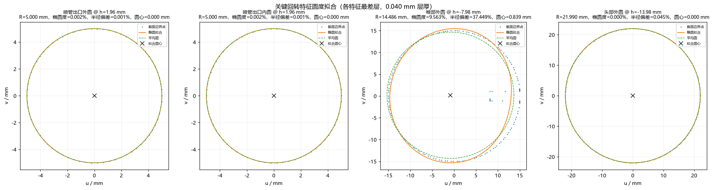
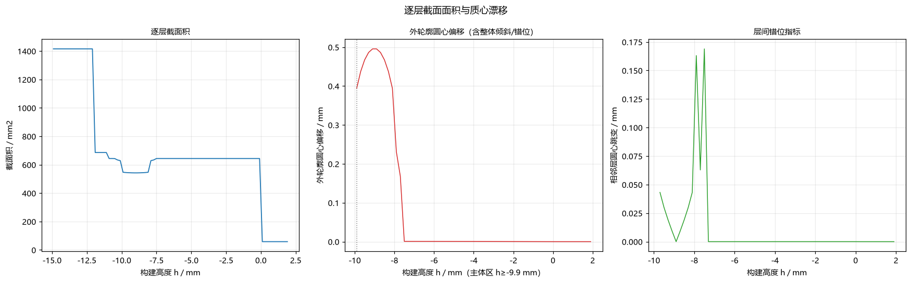
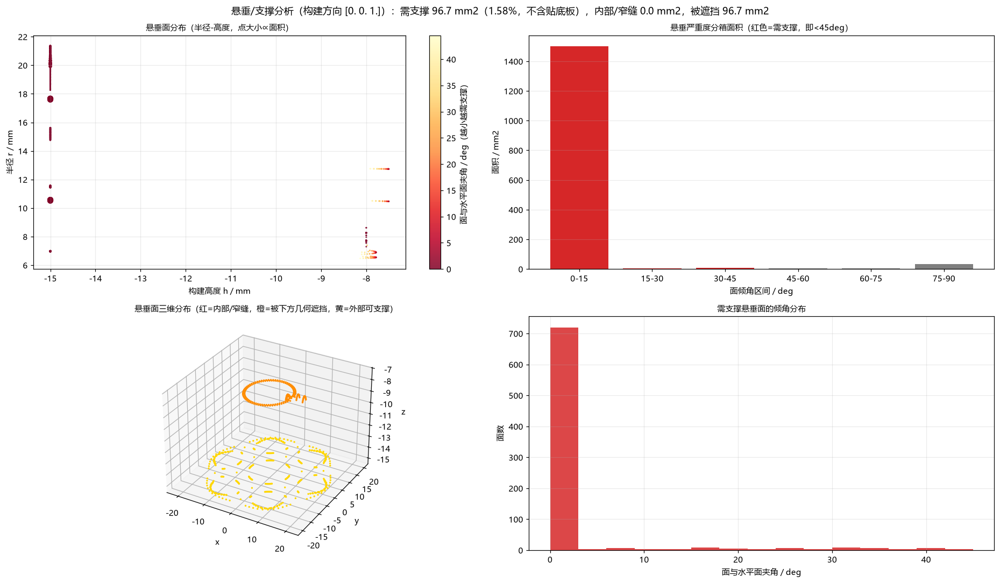
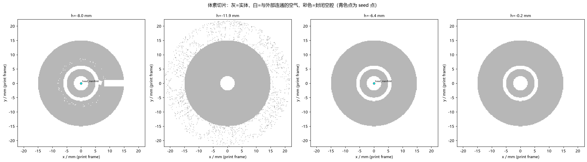
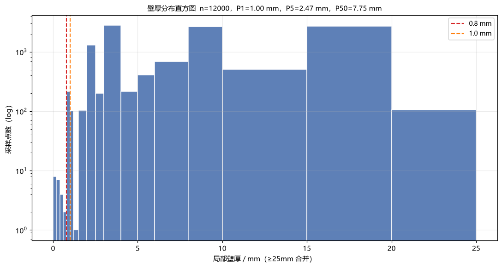
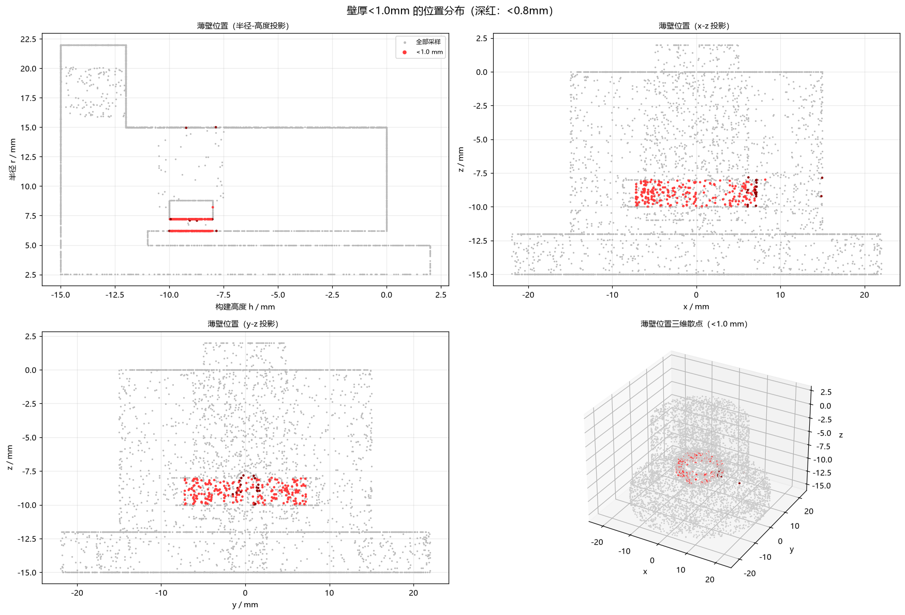

# YF-500 V3

文档AI等级：4

V3 是 YF-500 的喷注器设计阶段版本，本阶段的交付物不是整机参数，而是喷注器嵌件（injector insert）的三维模型与一组面向金属增材制造的打印可行性分析图表。V3 参数目录为空，尚无对外发布的总体参数、性能参数或流量数据，因此本页只描述图表的读图结果与模型文件的构成，不对任何整机指标作推断。

六张图表覆盖增材制造中最关键的几类几何校核：回转特征圆度拟合、逐层截面面积与质心漂移、悬垂与支撑需求、体素切片连通性、壁厚分布与薄壁位置。分析条件由图表标题给定——层厚 0.040 mm，构建方向 [0,0,1]，坐标系为打印坐标系（print frame）。模型侧提供 STEP 实体与两份 STL 网格，可分别用于再设计、渲染预览与切片交付。

## 仿真与图表

| 图表 | 说明 | 文件 |
| --- | --- | --- |
| fig_circle_fit | 关键回转特征圆度拟合（0.040 mm 层厚）。四联图给出四个特征断面的截面边界点、椭圆拟合、平均圆与拟合圆心：喷管出口外圆 @ h=1.96 mm，R=5.000 mm，椭圆度 0.002%，半径偏差 0.001%，圆心偏差 0.000 mm；喷管出口内圆 @ h=1.96 mm，R=5.000 mm，椭圆度 0.002%，半径偏差 0.001%，圆心 0.000 mm；喉部外圆 @ h=7.98 mm，R=14.486 mm，椭圆度 9.563%，半径偏差 37.449%，圆心 0.839 mm；头部外圆 @ h=13.98 mm，R=21.990 mm，椭圆度 0.000%，半径偏差 0.045%，圆心 0.000 mm。前三处残差极小，喉部外圆断面的散点明显偏离拟合圆 | { height="140" } [下载](assets/picture/fig_circle_fit.png) |
| fig_layer_profile | 逐层截面面积与质心漂移，含三个子图。左：逐层截面面积，h=-15.0~-12.3 mm 段维持约 1416 mm² 平台，h≈-12.3 mm 处陡降至约 690 mm²，-10.5~-8.3 mm 段降至最低约 545 mm²，-8.0~0 mm 主体段稳定在约 645 mm²，h≈0 之后降至约 40 mm²。中：外轮廓圆心偏移（含整体倾斜 / 错位，仅统计主体区 h≥-9.9 mm），在 h≈-9 mm 处达到最大约 0.50 mm，h≥-7.2 mm 后降为 0。右：相邻层圆心跳变，仅在 h≈-7.7~-7.2 mm 出现尖峰，最大约 0.165 mm，其余层为 0 | { height="140" } [下载](assets/picture/fig_layer_profile.png) |
| fig_overhang | 悬垂 / 支撑分析（构建方向 [0,0,1]）：需支撑面积 96.7 mm²（占 1.58%，不含贴底板），内部 / 窄缝 0.0 mm²，被遮挡 96.7 mm²。四联图分别为悬垂面半径-高度分布（点大小正比于面积）、悬垂严重度分箱面积、悬垂面三维分布、需支撑悬垂面的倾角分布。悬垂面集中在半径约 6.5~22 mm、高度 -15.5~-7.9 mm 区间；按倾角分箱后几乎全部悬垂面积落在 0~15° 箱（约 1480 mm²，以红色标为需支撑），15° 以上各箱均不足 40 mm² | { height="140" } [下载](assets/picture/fig_overhang.png) |
| fig_voxel_slices | 体素切片（灰=实体，白=与外部连通的空气，彩色=封闭空腔，青色点为 seed 点），取 h=-8.0、-11.9、-6.4、-0.2 mm 四个高度。各切片外轮廓半径约 15.5 mm，实体与白色空腔边界清晰；四张切片均未出现标识封闭空腔的彩色区域，与"内部 / 窄缝 0.0 mm²"的结论一致。h=-8.0 mm 切片中 head_manifold 环腔经 x≈+5~+15 mm 的径向通道与外部连通，属外流道开口 | { height="140" } [下载](assets/picture/fig_voxel_slices.png) |
| fig_wall_hist | 壁厚分布直方图，n=12000 个采样点，纵轴为采样点数（对数），横轴为局部壁厚（≥25 mm 合并）。统计分位：P1=1.00 mm，P5=2.47 mm，P50=7.75 mm；图中另以红色虚线标 0.8 mm、橙色虚线标 1.0 mm 阈值。壁厚主要集中在 3~4 mm、7.5~9 mm 与 15~20 mm 三个区间，1 mm 以下的采样点为个位数 | { height="140" } [下载](assets/picture/fig_wall_hist.png) |
| fig_wall_thin | 壁厚小于 1.0 mm 的位置分布（深红：<0.8 mm），四个子图为半径-高度投影、x–z 投影、y–z 投影与三维散点。红色薄壁点集中在 z≈-8~-9.2 mm、半径 r≈5.5~9 mm 的环形带内，另在 r≈14.9 mm 附近有零星红点；深红点与红点混布于同一环带，其余区域均为灰色（≥1.0 mm）采样点。薄壁环带与该高度的台阶轮廓重合，说明薄壁来自截面面积突变处的环形端面 | { height="140" } [下载](assets/picture/fig_wall_thin.png) |

读图要点：

- 打印件以回转薄壁结构为主：壁厚中位数 7.75 mm，但 1% 分位已降至 1.00 mm，薄壁集中在一处 z≈-9 mm 的环形带，是打印变形与后处理的主要关注区。
- 悬垂可控：需支撑面积仅 96.7 mm²（1.58%），且几乎全部为 0~15° 近水平面；内部 / 窄缝面积为 0，说明不存在无法清粉的封闭悬垂。
- 体素切片未检出色块标识的封闭空腔，头部腔体经径向通道与外部连通，粉末清理路径通畅。
- 回转精度分层明显：喷管出口内外圆与头部外圆的拟合残差均不超过 0.045%，而喉部外圆断面的半径偏差达 37.449%、圆心偏移 0.839 mm，该断面在切片后已不保持理想圆度，需回查模型对应高度处的截面。

## 三维模型

| 格式 | 文件 | 说明 |
| --- | --- | --- |
| STEP（AP214） | [YF-500_V3_injector_insert.step](assets/model/YF-500_V3_injector_insert.step) | 喷注器嵌件实体模型，由 Open CASCADE / build123d 于 2026-11-14 导出，可用于重新导入 CAD、修改特征与再切片；文件约 127 KB |
| STL（二进制） | [YF-500_V3_injector_insert.stl](assets/model/YF-500_V3_injector_insert.stl) | 4,316 个三角面的网格模型，单位 mm，包围盒 44.00 × 43.96 × 17.00 mm；供渲染、装配占位与切片预览 |
| STL（二进制，打印版） | [YF-500_V3_injector_insert_print.stl](assets/model/YF-500_V3_injector_insert_print.stl) | 与上一份 .stl 的字节数、三角面数及 SHA-256 均相同，实为同一份数据以 _print 命名另存，作为切片打印交付入口 |

## 说明

- 数据来源：本页所有数值取自图表标题、坐标轴刻度、图例标注与模型文件元信息，不含参数截图与仿真报告；V3 参数目录为空，故不设总体参数与性能参数小节，也不对流量、推力、比冲等指标作任何推断。
- 分析条件：层厚 0.040 mm、构建方向 [0,0,1] 由 fig_circle_fit 与 fig_overhang 标题给定；壁厚统计的采样点数、分位值与阈值线由 fig_wall_hist 标题与图例给定。
- 坐标系：图表的横轴为"构建高度 h"，纵轴为打印坐标系下的半径或 x / y / z，与整机装配坐标系的换算关系本阶段未给出，跨版本比对时需先统一基准。
- 特征命名：图中"喷管出口 / 喉部 / 头部"等字样沿用原图标题，其为嵌件模型上的局部特征名，与整机对应关系待与设计模型核对。
- 待核事项：`YF-500_V3_injector_insert_print.stl` 与 `YF-500_V3_injector_insert.stl` 的 SHA-256 完全相同（177A63F0...），若后续需要区分设计版与打印版（例如支撑、摆放基准或法向修复），需重新导出并区分命名。
- 本阶段资料范围：V3 目录不含仿真报告与试验数据，互击喷注的流场与雾化结论见 V2.1 版本的喷注器互击仿真内容。
